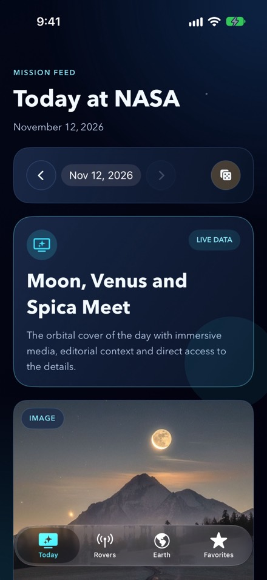
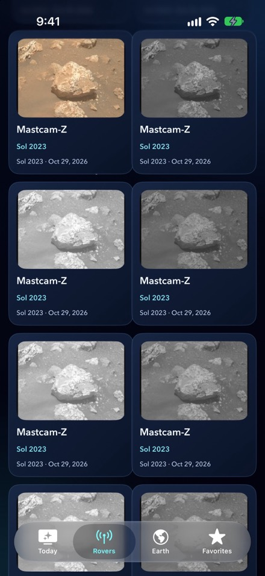
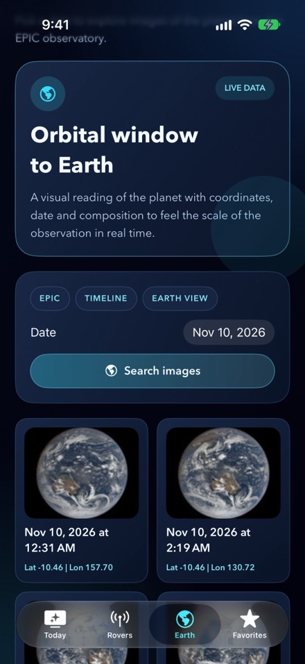
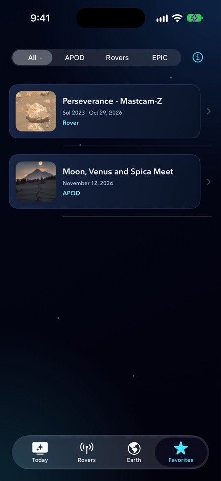
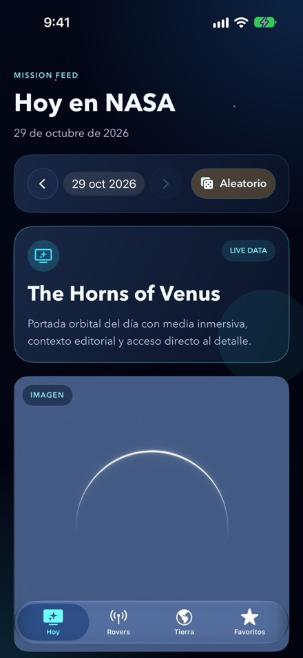
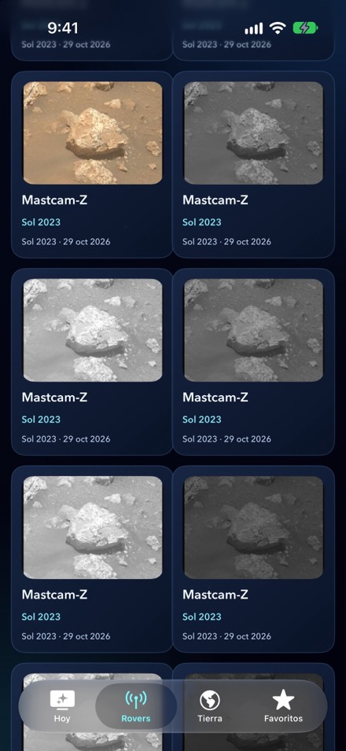
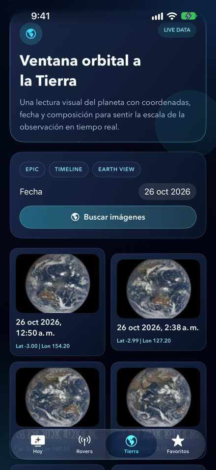
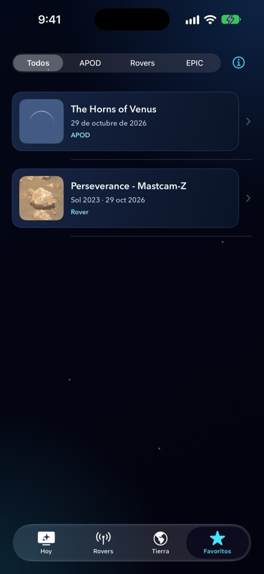

<p align="center">
  
</p>

<h1 align="center" id="english">NASA Exp</h1>

<p align="center">
  NASA imagery and mission data on your iPhone.<br>
  <a href="https://apps.apple.com/app/id6827700435">App Store</a> ·
  <a href="https://nhsiciliano.github.io/nasa-exp/">Website</a> ·
  <a href="https://nhsiciliano.github.io/nasa-exp/privacy-policy.html">Privacy policy</a>
</p>

<p align="center"><strong>English</strong> · <a href="#espanol">Español</a></p>

<p align="center">
  
  
  
  
</p>

NASA Exp is a free iPhone app, written in Swift and SwiftUI, that brings three public NASA image
sources into one place: the Astronomy Picture of the Day, raw photos from the Mars rovers and
Earth images from the EPIC camera.

NASA Exp is not an official NASA app and is not affiliated with or endorsed by NASA.

## Features

- **Today.** The Astronomy Picture of the Day with its title, explanation and credit. You can go
  back through earlier dates. When the day's entry is a YouTube or Vimeo video, it plays in the
  details screen.
- **Rovers.** Raw images from Curiosity and Perseverance, browsed by sol and filtered by camera.
- **Earth.** Images of the sunlit side of the Earth from NASA's EPIC camera, by date.
- **Favorites.** Save images from any tab. They are stored only on the device.
- **Widgets.** Three home screen widgets in small and medium sizes: the picture of the day, the
  latest photo from Mars and the Earth from EPIC.
- **Daily notification.** Optional, at the time you choose, scheduled on the device.
- **Share and save.** Share an image or save it to Photos.
- **Private.** No accounts, analytics, ads or tracking.
- **Two languages.** The interface is in English and Spanish.

## Requirements

- iPhone with iOS 17 or later.
- Xcode. The project is developed with Xcode 27, and CI builds it with the latest stable release.
- No third-party dependencies.

## Build and run

1. Clone the repository.
2. Create the secrets file and set your NASA API key. Keys are free at
   [api.nasa.gov](https://api.nasa.gov). Only the Earth tab uses it.

   ```bash
   cp Config/Secrets.example.xcconfig Config/Secrets.xcconfig
   ```

   `Config/Secrets.xcconfig` is ignored by git. Without it, a Debug build falls back to NASA's
   shared `DEMO_KEY`, which has low rate limits, and a Release build fails.
3. Open `nasa.exp.xcodeproj` and run the `nasa.exp` scheme, or build from the command line:

   ```bash
   xcodebuild -project "nasa.exp.xcodeproj" \
     -scheme "nasa.exp" \
     -configuration Debug \
     -destination 'platform=iOS Simulator,name=iPhone 17' \
     build
   ```

Run the unit tests with:

```bash
xcodebuild -project "nasa.exp.xcodeproj" \
  -scheme "nasa.exp" \
  -destination 'platform=iOS Simulator,name=iPhone 17' \
  test
```

Debug builds accept `-initialTab apod|rovers|epic|favorites` as a launch argument to open a
specific tab.

## Data sources

| Section | Source | API key |
|---|---|---|
| Astronomy Picture of the Day | `science.nasa.gov` (RSS feed for recent days, WordPress REST API for the archive) | No |
| Mars rovers | Raw image feeds on `mars.nasa.gov` | No |
| Earth (EPIC) | `api.nasa.gov` and `epic.gsfc.nasa.gov` | Yes |

## Project structure

| Path | Contents |
|---|---|
| `nasa.exp/App` | Root view and tab shell |
| `nasa.exp/Features` | One folder per tab: `APOD`, `Rovers`, `EPIC`, `Favorites` |
| `nasa.exp/Core` | Networking, persistence (SwiftData), design system, imaging, widget support |
| `nasa.expWidget` | WidgetKit extension with the three widgets |
| `nasa.expTests`, `nasa.expUITests` | Unit tests (XCTest) and UI tests |
| `Config` | Build configuration files and `Info.plist` |
| `docs` | Project documentation, plus the website served by GitHub Pages |

## Documentation

Most of the project documentation is written in Spanish.

- [Architecture](docs/architecture.md)
- [Production plan](docs/production-plan.md)
- [Testing](docs/testing.md)
- [QA checklist](docs/qa-checklist.md)
- [App Store notes](docs/app-store/README.md) (in English)
- [Guide for coding agents](AGENTS.md) (in English)

## Website

The site at [nhsiciliano.github.io/nasa-exp](https://nhsiciliano.github.io/nasa-exp/) is plain
HTML, CSS and JavaScript in `docs/`, published by GitHub Pages from the `main` branch. English is
at the root and Spanish under `es/`.

## Support

Questions and bug reports: [open an issue](https://github.com/nhsiciliano/nasa-exp/issues).

---

<h1 align="center" id="espanol">NASA Exp (Español)</h1>

<p align="center">
  Imágenes y datos de misiones de la NASA en tu iPhone.<br>
  <a href="https://apps.apple.com/app/id6827700435">App Store</a> ·
  <a href="https://nhsiciliano.github.io/nasa-exp/es/">Sitio web</a> ·
  <a href="https://nhsiciliano.github.io/nasa-exp/privacy-policy.html#es">Política de privacidad</a>
</p>

<p align="center"><a href="#english">English</a> · <strong>Español</strong></p>

<p align="center">
  
  
  
  
</p>

NASA Exp es una app gratuita para iPhone, escrita en Swift y SwiftUI, que reúne tres fuentes
públicas de imágenes de la NASA: la Imagen Astronómica del Día, las fotos crudas de los rovers de
Marte y las imágenes de la Tierra de la cámara EPIC.

NASA Exp no es una app oficial de la NASA ni está afiliada ni avalada por la NASA.

## Funciones

- **Hoy.** La Imagen Astronómica del Día con su título, su explicación y su crédito. Puedes
  volver a fechas anteriores. Cuando la entrada del día es un video de YouTube o Vimeo, se
  reproduce en la pantalla de detalle.
- **Rovers.** Imágenes crudas de Curiosity y Perseverance, por sol y con filtro por cámara.
- **Tierra.** Imágenes de la cara iluminada de la Tierra tomadas por la cámara EPIC de la NASA,
  por fecha.
- **Favoritos.** Guarda imágenes de cualquier pestaña. Quedan solo en el dispositivo.
- **Widgets.** Tres widgets para la pantalla de inicio, en tamaño pequeño y mediano: la foto del
  día, la última foto de Marte y la Tierra desde EPIC.
- **Aviso diario.** Opcional, a la hora que elijas, programado en el dispositivo.
- **Compartir y guardar.** Comparte una imagen o guárdala en Fotos.
- **Privada.** Sin cuentas, analítica, publicidad ni rastreo.
- **Dos idiomas.** La interfaz está en español y en inglés.

## Requisitos

- iPhone con iOS 17 o posterior.
- Xcode. El proyecto se desarrolla con Xcode 27 y el CI lo compila con la última versión estable.
- Sin dependencias de terceros.

## Compilar y ejecutar

1. Clona el repositorio.
2. Crea el archivo de secretos y pon tu clave de la API de la NASA. Las claves son gratuitas en
   [api.nasa.gov](https://api.nasa.gov). Solo la usa la pestaña Tierra.

   ```bash
   cp Config/Secrets.example.xcconfig Config/Secrets.xcconfig
   ```

   Git ignora `Config/Secrets.xcconfig`. Sin ese archivo, una compilación Debug usa la clave
   compartida `DEMO_KEY` de la NASA, que tiene límites bajos, y una compilación Release falla.
3. Abre `nasa.exp.xcodeproj` y ejecuta el scheme `nasa.exp`, o compila desde la terminal:

   ```bash
   xcodebuild -project "nasa.exp.xcodeproj" \
     -scheme "nasa.exp" \
     -configuration Debug \
     -destination 'platform=iOS Simulator,name=iPhone 17' \
     build
   ```

Las pruebas unitarias se corren con:

```bash
xcodebuild -project "nasa.exp.xcodeproj" \
  -scheme "nasa.exp" \
  -destination 'platform=iOS Simulator,name=iPhone 17' \
  test
```

Las compilaciones Debug aceptan `-initialTab apod|rovers|epic|favorites` como argumento de
lanzamiento para abrir una pestaña concreta.

## Fuentes de datos

| Sección | Fuente | Clave de API |
|---|---|---|
| Imagen Astronómica del Día | `science.nasa.gov` (feed RSS para los días recientes, API REST de WordPress para el archivo) | No |
| Rovers de Marte | Feeds de imágenes crudas de `mars.nasa.gov` | No |
| Tierra (EPIC) | `api.nasa.gov` y `epic.gsfc.nasa.gov` | Sí |

## Estructura del proyecto

| Ruta | Contenido |
|---|---|
| `nasa.exp/App` | Vista raíz y barra de pestañas |
| `nasa.exp/Features` | Una carpeta por pestaña: `APOD`, `Rovers`, `EPIC`, `Favorites` |
| `nasa.exp/Core` | Red, persistencia (SwiftData), sistema de diseño, imágenes, soporte de widgets |
| `nasa.expWidget` | Extensión de WidgetKit con los tres widgets |
| `nasa.expTests`, `nasa.expUITests` | Pruebas unitarias (XCTest) y pruebas de interfaz |
| `Config` | Archivos de configuración de compilación e `Info.plist` |
| `docs` | Documentación del proyecto y el sitio web que sirve GitHub Pages |

## Documentación

- [Arquitectura](docs/architecture.md)
- [Plan de producción](docs/production-plan.md)
- [Pruebas](docs/testing.md)
- [Checklist de QA](docs/qa-checklist.md)
- [Notas del App Store](docs/app-store/README.md) (en inglés)
- [Guía para agentes de código](AGENTS.md) (en inglés)

## Sitio web

El sitio en [nhsiciliano.github.io/nasa-exp](https://nhsiciliano.github.io/nasa-exp/es/) es
HTML, CSS y JavaScript a mano en `docs/`, publicado por GitHub Pages desde la rama `main`. El
inglés está en la raíz y el español en `es/`.

## Soporte

Preguntas y reportes de errores: [abre un issue](https://github.com/nhsiciliano/nasa-exp/issues).
